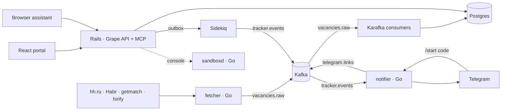

# RubyGopher

[](https://gitlab.com/mr-diesel/rubygopher/-/pipelines)
[](LICENSE)

A job-search workbench for Ruby and Go developers: it collects vacancies from four job boards, tracks every application and its history, reminds you to follow up, and hands any chat assistant a prompt to interview you for a specific vacancy.

It is also a portfolio project. The codebase is meant to be read: Rails with dry-rb operations, a Grape API with three kinds of credentials, Kafka between a Rails app and three Go services, a sandbox that runs untrusted code, and a test suite that never touches the network.

<!-- screenshots: docs/screenshots/{tracker,vacancies,console}.png -->

## Features

**Application tracker.** Paste a vacancy link and the application is recorded with the company and title resolved from the board. Every status change, note, interview and follow-up is an event in its history; cold outreach to companies is tracked the same way. A header badge and Telegram remind you of follow-ups that are due; a funnel view shows how many applications reached each stage, conversion, reply rate and median time to the first reply.

**Vacancy aggregator.** A Go fetcher polls hh.ru, Habr Career, getmatch.ru and hirify.me and publishes raw postings to Kafka; a Karafka consumer merges postings from different boards into one vacancy. Skills are extracted with a dictionary, no LLM. The feed filters by language, work mode, source, skill and novelty, shows every board a vacancy was seen on, and records an application in one click.

**Mock interviews.** No LLM keys in the backend: for an application it writes a prompt with the vacancy and its skills, your résumé, the gap between the two, the application's history and the rules of the interview (one question at a time, a verdict with weak topics at the end). Copy it into any chat, or let an assistant connected over MCP fetch it and save the verdict back as a note.

**AI assistants as a client.** A personal token turns any browser assistant into a tracker client: claude.ai, ChatGPT and other MCP clients connect to `/mcp/<token>` and get the tracker, the feed and the interview prompt as tools; anything that speaks HTTP gets an OpenAPI 3.1 schema and a guide. "I applied to this link", "any new remote Go jobs with Kafka", "interview me for the Acme position" each map to one call.

**Interview Helper and live console.** A personal cheat-sheet of questions with rich answers, and a browser console that runs Ruby, Ruby with the app loaded, or a Go program inside a locked-down sandbox against a throwaway database. Share the link and everyone edits and runs the same snippet live.

## How it works



```
backend/    Rails 8.1 on Ruby 4.0
  app/domains/<name>/   one directory per domain: api/ (Grape), operations/ (Dry::Operation), contracts/, queries/, consumers/, jobs/
  app/domains/agent/    OpenAPI generator, agent guide, MCP server (tools + prompts)
  app/models/           ActiveRecord models shared by the domains
  db/structure.sql      schema source of truth, Postgres DDL preserved
frontend/   React 19 + Vite SPA (JWT), four tabs: Tracker, Vacancies, Interview Helper, Live console
services/
  fetcher/    Go: job-board adapters behind one Source interface → Kafka
  notifier/   Go: tracker.events → Telegram, and /start codes back to Rails
  sandboxd/   Go: runs console snippets with timeouts, process-group kills, output caps and a concurrency limit
deploy/k8s/ kustomize base + minikube overlay
```

Rails writes domain events into an outbox table in the same transaction as the change; a Sidekiq relay publishes them to Kafka. The Go notifier is stateless: every event already carries the recipient's chat id. Sidekiq also runs the periodic work (follow-up reminders, outbox sweep, skill extraction, closing stale postings) through sidekiq-cron.

## Five things worth reading

| File | Why |
|---|---|
| [`record_application.rb`](backend/app/domains/tracker/operations/record_application.rb) | A `Dry::Operation`: validate, resolve the posting from a link (live hh.ru fetch with typed errors → 503, never a half-written row), find-or-create company and vacancy, refuse duplicates, write the application and its first event in one transaction |
| [`publish_job.rb`](backend/app/domains/outbox/jobs/publish_job.rb) | The transactional outbox relay: `FOR UPDATE SKIP LOCKED`, at-least-once delivery with an `event_id` for consumers, a crash can delay an event but never lose it |
| [`skill_matcher.rb`](backend/app/domains/aggregator/skill_matcher.rb) | Dictionary skill extraction: whole-word matching that survives "C++", "Node.js" and Cyrillic neighbours, case-sensitive for two-letter names so "go to the office" is not Go |
| [`runner.go`](services/sandboxd/internal/sandbox/runner.go) | The sandbox supervisor: per-context commands, boot allowance on top of the timeout, whole-process-group kill, output cap at write time, OOM kills reported distinctly |
| [`tools.rb`](backend/app/domains/agent/mcp/tools.rb) | The MCP tools: thin wrappers over the same operations and entities the REST API uses, so what one client records the other sees |

More decisions, with the alternatives that lost, in [docs/decisions.md](docs/decisions.md).

## Run it

Requirements: Docker with Compose, about 6 GB of RAM for the stack (Postgres, Redis, Kafka, two Rails processes, three Go services, the sandbox and its own Postgres).

```bash
docker compose up        # first run installs gems and npm packages: a few minutes
```

| URL | What |
|---|---|
| http://localhost:5173 | portal |
| http://localhost:3000/api/v1 | API (`/openapi.json`, `/agent/guide`) |
| http://localhost:3000/admin | admin panel for the default question library |
| localhost:29092 | Kafka from the host |

Sign up a portal user and, if you want the admin panel, an admin:

```bash
curl -X POST localhost:3000/api/v1/signup -H 'Content-Type: application/json' \
     -d '{"email":"me@example.com","password":"password123"}'
docker compose exec web bin/rails runner 'Admin.create!(email: "admin@example.com", password: "password123")'
```

Optional settings go into `.env` (see [`.env.example`](.env.example)):

| Variable | Purpose |
|---|---|
| `TELEGRAM_BOT_TOKEN`, `TELEGRAM_BOT_USERNAME` | a bot from BotFather; without the token the notifier logs messages instead of sending |
| `HH_TOKEN` | hh.ru application token, in case the public API refuses anonymous requests |
| `PUBLIC_HOST` | hostname of a tunnel (`cloudflared tunnel --url http://localhost:3000`) so a cloud assistant can reach `/mcp` |
| `FETCH_INTERVAL`, `FETCH_SOURCES`, `HIRIFY_REMOTE_TYPES` | fetcher cadence and sources |

The console's Rails context reads `sandbox_db`, rebuilt with invented data on every `docker compose up` (`bin/sandbox-db-reset` by hand). The console is enabled in development only: `PLAYGROUND_CONSOLE=true` turns it on elsewhere, and only behind the sandbox.

### Connect an assistant

1. Portal → ⚙ → *API token for assistants* → **Create token**. The panel shows the token and the MCP URL.
2. claude.ai (Settings → Connectors → Add custom connector), ChatGPT or any MCP client: paste `https://<host>/mcp/<token>`. The tools and the guide are discovered automatically.
3. Plain HTTP: `/api/v1/openapi.json` and `/api/v1/agent/guide` with the token as a bearer credential.

The token cannot rotate or reveal itself; regenerate it from the portal if it leaks, and the MCP URL changes with it.

## Tests and CI

```bash
docker compose run --rm web bin/ci       # rspec, rubocop, bundler-audit, importmap audit, brakeman
cd services/fetcher && go test ./...     # same for sandboxd and notifier; also run inside the image builds
```

Specs cover operations, queries, request specs, channels, jobs and Karafka consumers (no broker needed); external HTTP is stubbed, Go adapters run against httptest servers with recorded fixtures. GitLab CI runs all of it on every branch with Postgres and Redis service containers, then builds the five production images and pushes them to the registry from `main`. A fresh clone runs the suite without any secrets.

## Production

Every deployable part has a multi-stage Dockerfile producing a non-root image: `backend/Dockerfile` (jemalloc, Thruster, precompiled assets; the same image runs Puma, Sidekiq and Karafka), `frontend/Dockerfile` (Vite build behind nginx, API origin baked in with `--build-arg VITE_API_BASE`), `services/*/Dockerfile` (static Go binaries).

`deploy/k8s/base` is a kustomize base: Postgres, Redis and a single-node Kafka as StatefulSets, a `migrate` Job that loads the schema, seeds the skills dictionary and declares the topics, Deployments for web, Sidekiq, Karafka, the Go services and the SPA, one Ingress with two hosts. Secrets come from `deploy/k8s/secrets.example.yaml`; the sandbox is not deployed.

```bash
kubectl -n rubygopher delete job migrate --ignore-not-found   # a Job's template is immutable
kubectl apply -k deploy/k8s/base
kubectl -n rubygopher wait --for=condition=complete job/migrate --timeout=5m
```

`deploy/k8s/overlays/minikube` runs the same stack on minikube with locally built images; the commands are in its `kustomization.yaml`.

## Known limitations

- hh.ru answers 451/403 outside Russia, so the hh adapter is written against the documented API and verified only with recorded responses.
- Skill extraction is dictionary-based: it finds mentions, it does not tell "required" from "nice to have".
- Kafka is a single KRaft node; the manifests are for one cluster, not for HA.
- Inside the sandbox container the per-snippet memory limit is the container's cgroup, not a per-process rlimit (Ruby on slim images cannot use `RLIMIT_AS`).
- Last write wins in shared console sessions; there is no merge.

## Roadmap

Match vacancies against the user's own skills; feed the Interview Helper library into the interview prompt; push the header digest over ActionCable instead of polling; HPA and network policies for the cluster.

## License

MIT, see [LICENSE](LICENSE).
